# Method and implementation

MSF-ST investigates multi-scale representations for regional SST forecasting. `model/models/msf3_model.py` contains the proposed model family under the internal `MSFv3` name.

```mermaid
flowchart LR
    X[Past SST fields] --> P[Patch tokenizers: 2, 4, 8, 16]
    P --> E[Time and scale embeddings]
    E --> C[Concatenate tokens across scales]
    C --> ST[Spatial attention then temporal attention]
    ST --> H[Per-scale future heads and patch decoding]
    H --> F[Sum fusion]
    F --> R[Residual convolutional refinement]
    R --> Y[Future SST fields]
```

## Mapping the hypothesis to code

| Research component | Implementation | What it does |
| --- | --- | --- |
| Multi-scale representation | `MSFormerV3.tokenizers` | Conv2d with kernel/stride equal to patch size; fine scales retain more spatial tokens |
| Time and scale identity | `time_emb`, `scale_emb` | Add learned embeddings before attention; positional embeddings are optional and disabled by default |
| Factorized attention | `FactorizedSTBlock` | Spatial attention over concatenated scale tokens within each time step, then temporal attention per token, then an MLP |
| Future prediction | `future_heads`, `token_to_patch` | Pool time (`last` by default), project to future tokens and decode separate SST fields per scale |
| Fusion | `fusion` | Sum scale predictions, or weight them with a softmax gate derived from pre- or post-Transformer representations |
| Spatial refinement | `smoother` | Four convolutions applied after fusion in a residual connection |
| Spatial-structure objective | `losses.masked_gdl` | Match magnitudes of adjacent horizontal/vertical gradients, only where both pixels are ocean |

The default input/output shapes are `(B, 14, 1, 32, 32)` and `(B, 7, 1, 32, 32)`. At the four default scales, each input field produces 256 + 64 + 16 + 4 = 340 tokens. Attention can therefore exchange information across scales; the scale branches do not use independent Transformer backbones.

## Variants preserved in the release

- `MSFv3`: sum fusion unless explicitly overridden.
- `MSFGv3`: `gated` fusion, with weights calculated before the Transformer.
- `MSFG2v3`: `gated2` fusion, with weights calculated after the Transformer.

`model_train/base/msf3_train.py` chooses the class from `configs.py`. The current default is `MSFv3` with sum fusion, matching the saved Full4 revision configuration. The full model has 1,611,132 parameters. Gated classes remain available as variants; changing fusion defines a different experiment.

For the public default, training uses masked MSE + 0.5 × spatial GDL on normalized fields. GDL is the sum of horizontal and vertical mean absolute gradient-magnitude differences. Each direction includes an edge only when both adjacent cells are ocean. The trainer also retains temporal-weighted MSE, temporal GDL, auxiliary-loss and MoE-monitor options; these are off in the primary configuration.

## Main revision settings

| Setting | Value |
| --- | --- |
| Input / forecast length | 14 / 7 days |
| Grid / valid ocean cells | 32 × 32 / 1,021 |
| Patch scales / tokens | 2, 4, 8, 16 / 340 tokens per input time |
| Embedding dimension / blocks / heads | 128 / 4 / 4 |
| MLP ratio / dropout | 4 / 0 |
| Embeddings | Learned time and scale; spatial positional embeddings disabled |
| Fusion / refinement | Sum; residual CNN with four 3 × 3 convolutions and 40 parameters |
| Optimizer | AdamW, LR 1e-4, weight decay 0, β=(0.9, 0.999), ε=1e-8 |
| Batch / budget / patience | 64 / 200 epochs / 20 epochs |
| Objective | Masked MSE  + 0.5 × spatial GDL |
| Selection | Lowest global ocean-masked Validation RMSE |
| Arithmetic | Float32; AMP and TF32 disabled; deterministic algorithms |
| Repeated fits | Seeds 42–46 |

Each scale decoder produces an additive intermediate field before sum fusion and CNN refinement. Its output magnitude describes that field; it is not automatically a fraction of final prediction accuracy. Attention plots describe token reference patterns. Their stored analysis scope is documented in the [figure index](../figures/README.md).

The saved [per-seed settings](run_configs/MSF_ST/seed42.json) and [experiment records](experiment_record.md) give the model and evaluation scope used for the numerical results.
